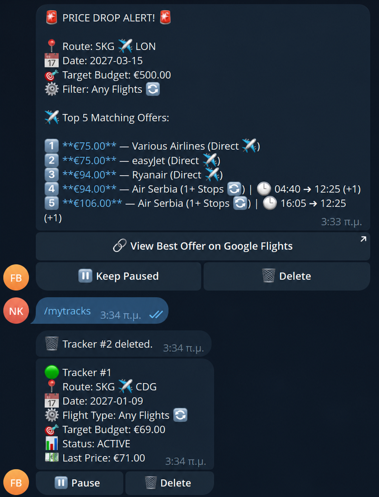

# FareBot

FareBot is an asynchronous Telegram bot that tracks Google Flights prices and notifies you when fares drop below your budget.

Searching flight prices manually across multiple dates requires checking Google Flights repeatedly and recording price changes by hand. FareBot replaces this workflow by automating recurring price searches in the background, storing historical offers in a local SQLite database and sending instant Telegram alerts when a matching fare is found. It is built for developers and self-hosters who want automated flight price monitoring without third-party subscriptions.



## Features

- **Instant Flight Search (`/search`)**: Search single-date or date-range fares using Google Flights data, with direct/connecting badges and historical price baselines (`XX% OFF`).
- **Interactive Date Picker**: Visual inline calendar with month navigation and range-selection mode across all wizards.
- **Regional Deal Exploration (`/explore`)**: Discover top flight deals across 8 global regions with customizable sorting (`Highest Discount %`, `Cheapest Price`, or `Both`).
- **Automated Weekly Digests (`/digest`)**: Schedule recurring weekly deal reports delivered directly via Telegram on your chosen day and time.
- **Background Price Tracking (`/track` & `/mytracks`)**: Monitor routes in the background with instant push notifications when prices drop below your budget.
- **Live ETAs & Search Cancellation**: Long searches run in the background with real-time progress (`around HH:MM`) and a Stop button, so the bot keeps responding meanwhile.
- **Self-Hosted Infrastructure**: Whitelisted user access control, SQLite storage, automated daily database cleanup, and embedded HTTP health checks for Render/Railway.

## Requirements

- Python 3.10 or higher
- A Telegram bot token created via BotFather
- Your numeric Telegram User ID

## Installation

Clone the repository and install dependencies in a virtual environment:

```bash
git clone https://github.com/nikosklms/FareBot.git
cd FareBot
python3 -m venv venv
source venv/bin/activate
pip install -r requirements.txt
```

## Quick Start

Copy `.env.example` to `.env` and set your credentials:

```bash
cp .env.example .env
```

Edit `.env` to supply your bot token and numeric Telegram user ID:

```env
TELEGRAM_BOT_TOKEN=123456789:ABCdefGHIjklMNOpqrsTUVwxyz
ALLOWED_USERS=123456789
```

Start the bot:

```bash
python main.py
```

Send `/start` to your bot on Telegram to verify access.

## Configuration

FareBot reads configuration from environment variables loaded via `.env` at startup.

| Variable | Description | Default |
| --- | --- | --- |
| TELEGRAM_BOT_TOKEN | Telegram bot token obtained from BotFather | Empty string |
| ALLOWED_USERS | Comma-separated list of numeric Telegram User IDs allowed to use the bot | Empty string |
| FAREST_DB_PATH | File path for SQLite database storage | `farebot.db` inside root directory |
| TIMEZONE | Timezone for weekly digest delivery times, e.g. `Europe/Athens` | The server's timezone |
| PORT | Port number for the HTTP health check web server | `10000` |

`ALLOWED_USERS` is re-read on every message, so adding a user takes effect without a restart. The database schema is upgraded automatically on startup.

Internal operational limits configured in `config.py`:

| Parameter | Value | Description |
| --- | --- | --- |
| MIN_POLL_INTERVAL_HOURS | 6 | Minimum allowed background polling interval in hours |
| MAX_TRACKERS_PER_USER | 20 | Maximum active trackers and digests per user |
| MAX_CONSECUTIVE_FAILURES | 3 | Failed search attempts before a tracker is paused |

## Usage

Interact with FareBot using standard Telegram chat commands and interactive inline keyboards.

### Commands

| Command | Description |
| --- | --- |
| `/start` | Verify authorization and view bot status |
| `/help` | View command syntax and usage instructions |
| `/search` | Start flight search wizard for single dates or date ranges |
| `/track` | Create a recurring background price tracker for a specific route and date |
| `/explore` | Interactively search top flight deals by region (Europe, Islands, Asia, Middle East, Americas, etc.) |
| `/digest` | Schedule a recurring weekly flight deal digest with custom day, time, sorting, and deal limits |
| `/mytracks` | Manage trackers and weekly digests: pause, resume, delete, or edit dates, budget, flight type, check frequency and digest schedule |
| `/cancel` | Cancel the current wizard or stop a running search |

Every command also accepts its answers as arguments to skip the wizard:

```text
/search ATH LON 2026-09-01..2026-09-15 direct
/track ATH LON 2026-09-01 150 direct
/explore ATH europe 30 100 10          # origin, region, days ahead, budget (0 = any), results
/digest ATH europe 30 80 Sunday@15:00 10
```

## Project Layout

| Path | Contents |
| --- | --- |
| `main.py` | Startup: single-instance lock, health check server, application wiring |
| `bot/handlers/` | One module per command; wizards are built from the shared steps in `bot/wizard.py` |
| `bot/formatting.py` | All HTML message rendering |
| `daemon/scheduler.py` | Background jobs: tracker checks, weekly digests, nightly cleanup |
| `database/` | SQLite access, typed `Tracker` / `Digest` models and schema migrations |
| `providers/fast_flights.py` | Google Flights fetching and parsing |
| `services/` | Deal discovery engine, airport data and fuzzy airport search |

## Testing

Run the test suite with `pytest`. The tests drive the real bot through a fake Telegram API, so no network access or bot token is needed.

Tests that query the real Google Flights site are skipped by default. Run them with `pytest -m live`.

To measure throughput against Google Flights (queries per minute, request time, rate limiting, CPU and memory), run `python -m tools.benchmark`. It sends real requests, so start with the defaults.

## Limitations and Known Gaps

- Google Flights scraping depends on fast-flights and raw HTML JSON parsing. If Google updates internal payload structures, flight queries may fail until parser definitions are updated.
- Automated requests sent too frequently may trigger HTTP 429 rate limiting from Google Flights. The minimum poll interval is restricted to 6 hours to reduce block risks.
- Round-trip flight tracking is not currently supported; trackers monitor one-way travel segments.
- Payment processing or ticket booking is not handled directly by the bot. Users must click generated Google Flights links to complete purchases on external airline sites.

## Disclaimer

This project is an independent open-source tool created strictly for personal and educational use. It is not affiliated with, authorized by, endorsed by or sponsored by Google LLC or Google Flights. Users are responsible for complying with applicable terms of service when running personal automated queries.

## License

This project is licensed under the MIT License. See the `LICENSE` file for details.

